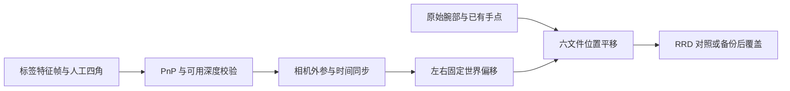

# 手部数据与修正路径

项目有两条手部路径：人工审核后平移已有手点，以及独立的 MANUS 重建工具。两者都在世界系中显示，但不能混用修正结果。

## 人工审核后的主路径

`Δ = 标签中心世界坐标 − 同时刻原始腕部位置`。同侧腕部与 21 个关节加同一个 Δ，旋转保持不变；不重新识别骨架侧别，不生成手型。`action.parquet` 和 `observation.state.parquet` 的腕部位置同步修正。

`hand_{left,right}_points.parquet` 已是世界坐标，不再乘腕部位姿，也不能靠交换文件名修正侧别。RRD 直接读取共用修正文件，避免再次施加偏移；覆盖后从登记的 `.bak` 读取原始对照。

深度校验要求时间差 ≤5 ms；有效点、覆盖率与平面残差检查失败时保留 PnP，记录 `unverified_pnp_preview`。无深度时仍可显示 RGB 和已有世界坐标手点。骨架与点云只是同系叠加，不把关节吸附到最近点云。

操作、备份和字段保留约定见 [审核与重建指南](review_rebuild.md)。

## 独立 MANUS 重建工具

原始查看和手部修复工具可从 `observation.hand_skeleton.parquet` 的 50 个局部节点重建手点，并使用屈指信号核查左右分组。这不是上述人工审核路径的必经步骤。

- 每手取局部索引 `0,1,2,3,4,6,7,8,9,11,12,13,14,16,17,18,19,21,22,23,24`。
- 当前安装假设：`p_tracker = p_manus[y,z,x] + [0,-0.085,-0.058]`，再 `p_world = R_wrist p_tracker + t_wrist`，尚未独立标定。
- 点云使用 `p_camera = z K⁻¹[u,v,1]`，再经 `T_world_head T_head_camera` 转换；深度 mm→m。
- 输出是 MANUS 21 关节，不是 MANO。标签中心不等于 Tracker 内部原点，表面距离不等于解剖关节误差。

可选刚体安装标定见 [手部标定](hand_calibration.md)，查看与修复入口见 [Rerun 说明](../ego_data/README_rerun.md)。
