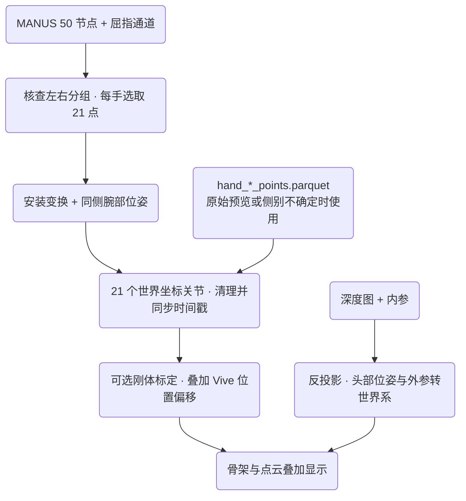
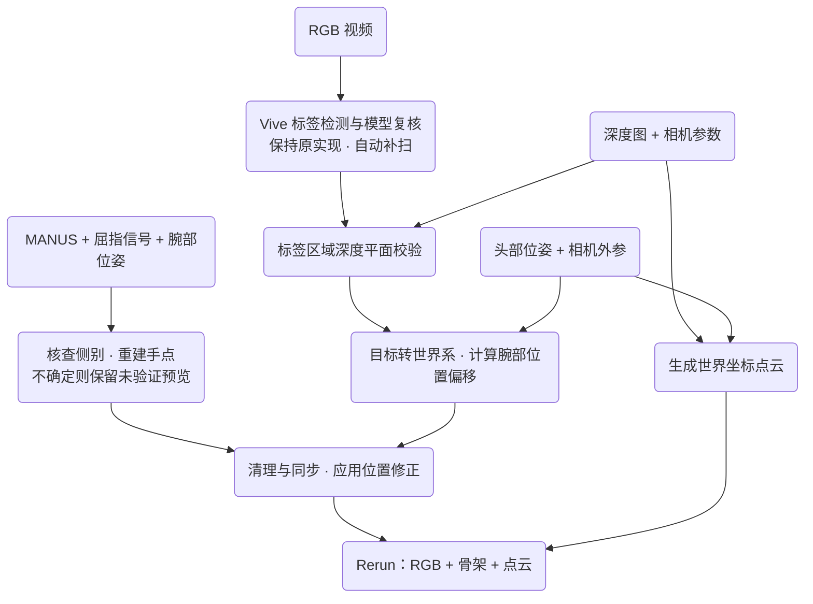

# 手部数据与修复流程

## 从文件到点云

骨架与点云是两路独立数据，在同一世界系中叠加；不是将关节吸附到最近点云点。

- `observation.hand_skeleton.parquet`：50 个 MANUS 局部节点。用 `observation.hand_pose.parquet` 的屈指信号核查两组物理侧别。
- 每手选取局部索引 `0,1,2,3,4,6,7,8,9,11,12,13,14,16,17,18,19,21,22,23,24`，重建时绑定同侧 `observation.{side}_wrist_pose.parquet`。
- 当前安装假设：`p_tracker = p_manus[ y,z,x ] + [0,-0.085,-0.058] m`，随后 `p_world = R_wrist p_tracker + t_wrist`。该安装假设尚未独立标定。
- `observation.hand_{left,right}_points.parquet` 已是世界坐标，按关节字段名读取，不能再次乘腕部位姿，也不能通过交换文件名修复侧别。
- 点云按 `p_camera = z K⁻¹[u,v,1]` 反投影，再通过 `T_world_head T_head_camera` 转到世界系；深度从毫米转为米。
- Vive 位置偏移为 `Δ = p_target_world − t_wrist`，同侧全部关节加同一个 `Δ`。可选刚体标定先在 Tracker 局部系应用，再加世界偏移。

## 当前新方案

图中为自动导出的主路径。刚体安装标定是可选步骤，需通过独立验证后由 `--hand-calibration` 接入。缺少深度资源时仅显示可用 RGB 与原始局部节点，不执行点云配准。

深度校验要求 RGB/深度内参一致、时间差不超过 5 ms；标签内部至少 30 个有效点、覆盖率至少 60%、平面内点至少 85%、90 分位平面残差不超过 5 mm。通过后取检测中心射线与平面交点；失败时保留原 PnP 位置并标记 `unverified_pnp_preview`。原值及依据写入 `samples[].depth_refinement`。

## 当前验证范围

40 条样本中，屈指信号支持 21 条源分组相反、9 条一致、10 条不确定。原手点均能由固定 `left=0, right=25` 分组和同名腕部变换重建，说明侧别绑定问题已经存在于派生文件，不是当前读取器交换了列。尚未取得本批采集转换代码，不能断定更上游的设备枚举原因，也不能据此判断传感器损坏。

40 条样本均完成选定帧录制检查，其中 8 条使用 RGB/局部节点回退。10 个参考样本另生成 33 帧对比录制。选定帧的 20 个手部实例中，逐手点云表面距离中位数的总体中位数由 54.7 mm 降至 14.8 mm，14 个改善、6 个未改善；18 个标签位置中 15 个通过深度校验。

上述表面距离不是解剖关节误差。当前没有独立关节真值，标签到 Tracker 内部原点、Tracker 到手部的变换仍需标定，尚未证明整段稳定贴合。输出是 MANUS 21 关节骨架，不是 MANO 网格。操作方法见 [Rerun 说明](../ego_data/README_rerun.md)，标定方法见 [手部安装标定](hand_calibration.md)。
