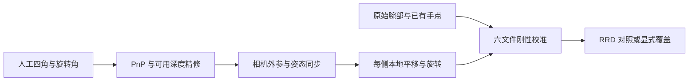

# 手部数据与校准模型

本文定义修正与同步算法。浏览器审核修正已有世界坐标手点；独立 MANUS 工具从局部骨架重建手点，两条路径不能叠用。操作入口见 [人工审核](user_guide.md) 与 [RRD 说明](../ego_data/README_rerun.md)。

<a id="rigid-calibration"></a>

## 标签刚性绑定



左右手分别使用自己的参考帧。设源腕部世界位姿为 `(R(t), p(t))`，参考时刻标签中心世界位置为 `c₀`，审核角度为 `(α, β, γ)`：

```text
d = R₀ᵀ (c₀ − p₀)
C = Rx(α) Ry(β) Rz(γ)
p′(t) = p(t) + R(t)d
R′(t) = R(t)C
q′(t) = p′(t) + R(t)C R(t)ᵀ(q(t) − p(t))
```

`d` 是固定本地平移，`C` 是本地内禀 XYZ 旋转，`q` 是原世界手点。偏移随腕部转动，刚性变换保持手型和关节间距离。假定标签与设备之间不滑动；单帧残差为零不能证明整段实测精度。

默认 `C` 为单位矩阵。手动输入与“四角校正”均保存为同一角度字段；四角校正取同一个 PnP 标签平面，以 `C = R_source_cameraᵀ R_corner_camera` 换算，不改变中心。操作约定见 [方向调整](user_guide.md#adjustments)。

<a id="synchronization"></a>

### 同步与字段保真

- 腕部文件与 `action/state` 使用各自记录中的腕部位姿；手点按自身时间戳同步原始腕部。
- 使用真实时间戳，位置线性插值、旋转 SLERP，插值区间不超过 50 ms，禁止外推。
- 腕部六维位姿不完整时整组不修改；手点无同步腕部时该侧该行不修改；单个关节 xyz 不完整时保留该关节。
- 保留行数、行序、时间戳、字段类型、Arrow 元数据和非目标字段。零旋转直接保留源欧拉角；非零旋转按标定中的欧拉顺序和单位编码。跳过数量写入修正清单。

已有 `observation.hand_{left,right}_points.parquet` 是世界坐标，不能再次按局部点变换到世界系，也不能靠交换文件名修正侧别。RRD 读取共用修正文件，覆盖后从输出目录里的原始基线读取对照。

深度精修要求 RGB 与深度时间差不超过 5 ms；有效点、覆盖率或平面残差检查失败时保留 PnP，记录 `unverified_pnp_preview`。骨架与点云仅在同一坐标系叠加，不将关节吸附到最近点云。

<a id="manus-reconstruction"></a>

## 独立 MANUS 重建

原始查看工具可从 `observation.hand_skeleton.parquet` 的 50 个局部节点重建手点，并用屈指信号核查左右分组。这不是浏览器审核的必经步骤；另行修改源骨架时需同步 [数据集元数据](review_rebuild.md#dataset-metadata)。

- 每手取局部索引 `0,1,2,3,4,6,7,8,9,11,12,13,14,16,17,18,19,21,22,23,24`，输出 MANUS 21 关节，不是 MANO。
- 当前安装假设：`p_tracker = p_manus[y,z,x] + [0,−0.085,−0.058]`，再通过源腕部位姿转换到世界系；该安装关系尚未独立标定。
- 点云通过内参反投影，再经 `T_world_head T_head_camera` 转到世界系。表面距离不能代表解剖关节误差。

入口见 [Rerun 说明](../ego_data/README_rerun.md)，独立对应点拟合见 [手部安装标定](hand_calibration.md)。
