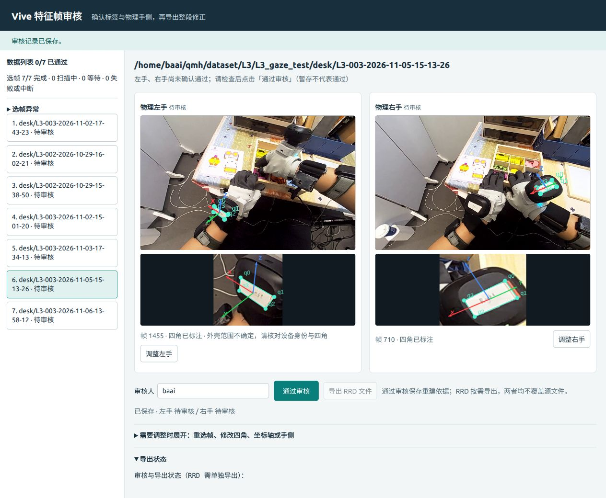
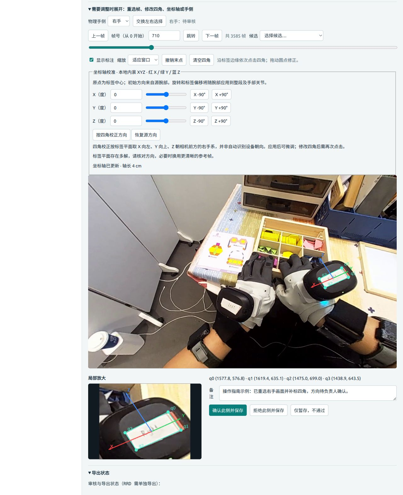
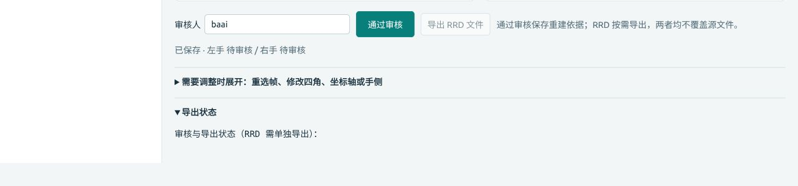

# 人工审核上手指南

以本机 `desk` 目录中的 7 条数据为例。环境已配置好，按以下步骤操作即可。

## 1. 启动程序

打开一个终端，复制执行：

```bash
cd /home/baai/qmh/vive_repair
bash scripts/run_cv.sh \
  /home/baai/qmh/dataset/L3/L3_gaze_test/desk \
  outputs/desk_review --jobs 4
```

再打开一个终端，执行：

```bash
cd /home/baai/qmh/vive_repair
python3 -m vive_correct review --out outputs/desk_review --port 18775
```

在浏览器打开 <http://127.0.0.1:18775>。保持两个终端运行；数据会陆续出现在左侧，无需等全部选帧结束。两条命令中的 `outputs/desk_review` 必须一致。

## 2. 选择数据并检查

点击左侧一条“待审核”数据，分别检查左右两张参考图。找到**手腕上黑色设备表面的白色矩形标签**，确认标注贴合白标签的四个角，没有框到设备外壳或背景。

**左右手以佩戴者本人为准，不以画面左右为准。** 可结合手臂位置判断；无法确定时先暂存。



**图 1**　① 左侧列表：选择数据。② 上方两张图：核对手侧和目标。③ 下方放大图：检查四角。④ “调整左手／调整右手”：进入编辑。

## 3. 需要时调整

点击对应的“调整左手”或“调整右手”：

1. **换图**：从“候选”选择另一张，或拖动时间轴；也可输入帧号后点“跳转”。选择标签清晰、四角完整的画面。
2. **修四角**：提高“缩放”，拖动角上的圆点；需要重画时点“清空四角”，沿白标签边缘顺时针依次点击四个角。点错可“撤销末点”。
3. **改手侧**：确认左右选反后，点击“交换左右选择”，再检查两侧。
4. **调方向**：需要按标签调整时点“按四角校正方向”，按负责人提供的示例核对红、绿、蓝箭头；可用角度输入、滑条或 ±90° 微调。“恢复源方向”可撤回方向调整。修改四角后需重新点击校正。



**图 2**　① 顶部：选手侧、换帧与缩放。② “坐标轴校准”：调整箭头方向。③ 大图：点击或拖动四角。④ 底部：写备注并保存。不确定方向时不要猜测，暂存并请负责人确认。

## 4. 保存并通过审核

- **仅暂存，不通过**：保存进度，留待继续检查。
- **确认此侧并保存**：保存当前手的检查结果，另一只手仍需检查。
- **通过审核**：两侧都检查完成后，填写“审核人”（姓名或工号），点击此按钮。

等待页面明确显示审核成功，再处理下一条；仅暂存或确认单侧不代表整条已通过。之后若修改选帧、四角或方向，需要重新通过审核。



**图 3**　① “审核人”：填写身份。② “通过审核”：提交整条。③ “导出 RRD 文件”：按需生成查看文件。④ “导出状态”：查看进度或失败原因。图中为暂存状态，导出按钮在通过审核后启用。

## 5. 按需导出与查看

审核成功不会自动导出。需要查看结果时，点击“导出 RRD 文件”，等待导出完成；排队时可以审核其他数据，同一条不要重复提交。

完成后，在另一个终端打开结果：

```bash
cd /home/baai/qmh/vive_repair
python3 -m vive_correct view outputs/desk_review
```

遇到问题时：**找不到标签**，先换帧，仍找不到就备注暂存；**方向无法判断**，暂存后请负责人确认；**保存或导出报错**，记录数据名称和提示，交给负责人处理，不把排队或失败当作完成。
