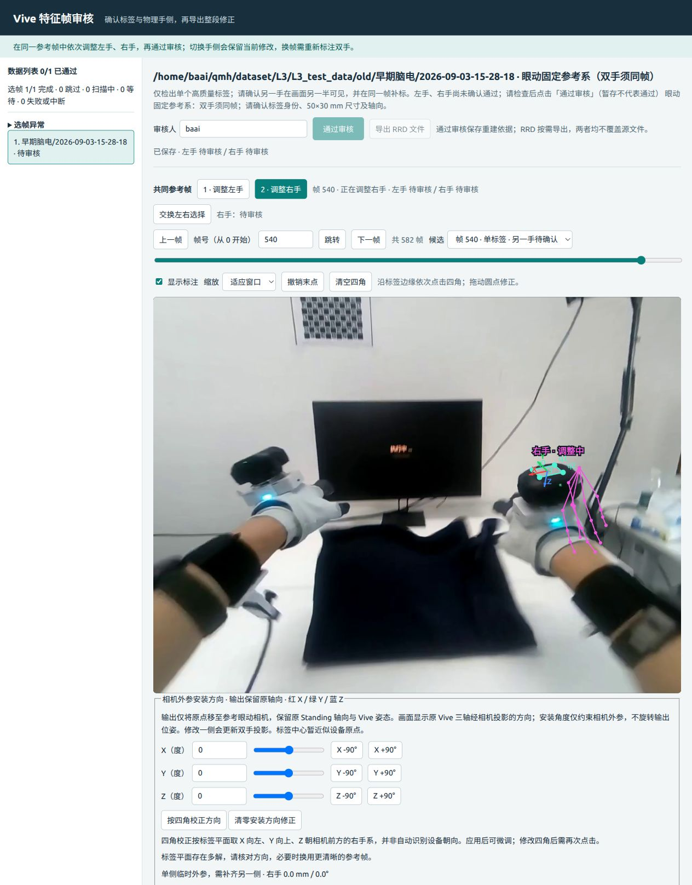

# 人工审核指南

两种模式均按“检查 → 调整 → 暂存或通过 → 手动导出”操作。先按 [快速开始](../README.md#快速开始) 选帧并启动审核，浏览器会根据保存的模式展示对应界面。

## 1. 检查参考帧

选择左侧一条待审核数据，找到手腕设备表面的 **50 × 30 mm 白色矩形标签**。确认四角贴合标签，没有框到外壳、反光或背景。物理左右手以佩戴者本人为准；无法确定时备注暂存。

### 矫正左目：左右分别审核

首页显示左右参考图和局部放大图，两侧可以来自不同帧。点击“调整左手”或“调整右手”进入对应编辑区；换帧只影响当前侧。

### 眼动固定参考系：同帧依次审核

界面只显示一张共同参考帧，同时叠加两侧四角、三轴及可用手点。点击 **1 · 调整左手**、**2 · 调整右手** 切换；当前侧可编辑，另一侧淡化显示。

切换手侧保持画面及各自编辑内容。“确认左手并调整右手”保存后自动切到右手；也可直接切换，最后一次暂存两侧修改。

图中右侧标签提供临时轴向预览，左侧仍需补标，安装方向尚未确认；该截图仅验证界面功能。

## 2. 调整四角与方向

1. **选帧**：使用候选、时间轴、上一帧／下一帧或帧号跳转。眼动模式要求双手分处画面两半；单标签候选需先确认另一手可见，再补齐另一侧四角。通过审核时两侧标签均需有效。
2. **修四角**：缩放画面，拖动圆点；需要重画时点“清空四角”，沿标签轮廓依次点击四角。点错可“撤销末点”。
3. **核对侧别**：候选归属相反时点“交换左右选择”，然后重新确认两侧。
4. **调方向**：检查红 X、绿 Y、蓝 Z 箭头，用角度输入、滑条或 ±90° 按钮调整。“按四角校正方向”提供标签平面的几何方向，不能自动识别设备物理朝向。修改四角后如需重新校正方向，应再次点击。

左目模式的初始方向来自源腕部，“恢复源方向”将角度归零。眼动模式仅移动输出原点、保留原 Vive 姿态；图中三轴是原设备轴的相机投影。角度编辑的是估计相机外参所需的标签安装方向约束，不改写输出姿态，“清零安装方向修正”恢复零修正。修改任一侧四角或角度会同时更新两侧并清除确认状态。两种模式均需核对设备实际朝向。

**眼动模式换帧会同时更新双手**，清除不属于新帧的四角、候选关联和确认状态；旋转角与备注保留，需重新核查。候选列表按共同帧展示，选择后同时载入该帧的两侧四角；标记“单标签 · 另一手待确认”的帧不保证双手可见，需检查另一半画面并补齐缺失四角。加载旧的不同帧候选时，界面优先采用有标注的左手帧，否则采用右手帧，并提示补标另一侧；暂存前不改写原记录。

眼动轴向状态会显示每侧位置／方向残差。单侧临时外参仅用于预览；双侧联合拟合须满足每侧 ≤30 mm、≤15° 才能通过审核。超限时核对四角、物理侧别和标签安装方向，不通过独立移动一只手来消除误差。

## 3. 保存与审核

- **仅暂存，不通过**：保存两侧当前选择、角度和备注，留待继续检查。
- **确认此侧并保存**：确认当前物理手侧；眼动模式确认左手后自动进入右手。
- **拒绝此侧并保存**：记录误检或不可用候选，之后重新选帧或标注。
- **通过审核**：两侧检查完成后填写审核人，提交整条数据。服务端重新计算和校验，成功后才显示已通过。

暂存或确认单侧不代表整条通过。缺少四角、同步位姿或有效共同帧时保持待处理；修改已通过记录后需要重新审核。

## 4. 手动导出

审核成功后点击 **导出 RRD 文件**，等待导出完成。审核与导出是独立任务，不覆盖源数据；处理期间可切换到其他数据继续审核。

查看录制、批量导出和重建 Parquet 的命令见 [导出与重建](review_rebuild.md)。保存或导出报错时，保留样本名称及页面提示，按该页排查，不将排队或失败视为完成。
